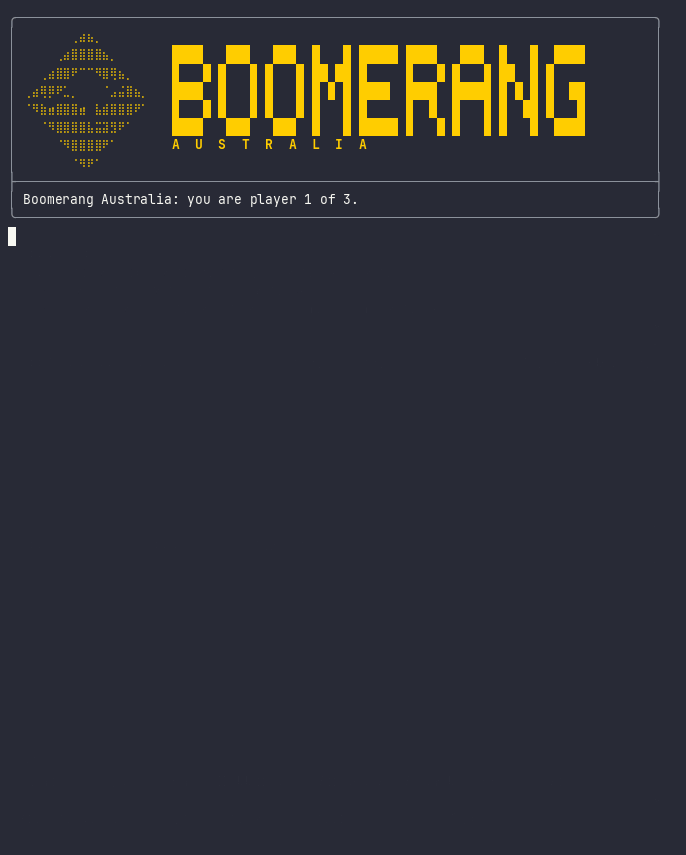

# Boomerang Australia



The recording shows the first round of a game against two bots. How it is made: [docs/demo.md](docs/demo.md).

Home Exam, Programvaruteknik (Z7005E), Luleå University of Technology, 2026

## Requirements

A JDK, version 21 or newer, from https://adoptium.net/. Nothing else: the Gradle wrapper (`./gradlew`)
downloads the build tool, the Kotlin compiler and JDK 21 itself if it is missing.

On Windows write `.\gradlew.bat` wherever a command below says `./gradlew`.

## Build and test

| What | Command |
|---|---|
| Build and run all tests | `./gradlew build` |
| Run the tests only | `./gradlew test` |
| Show the faults of the original | `./gradlew legacyBugs` |

`./gradlew legacyBugs` runs 19 tests against the original `BoomerangAustralia.java`, and all 19 are
expected to fail: each states a rule that the original breaks (see `docs/legacy-findings.md`). Gradle
therefore ends that command with "BUILD FAILED".

## Play

A game needs one server and one client per human player. Start the server first, then each client in a
terminal of its own. The server waits until all humans have joined.

Start a server, here for 1 human and 1 bot:

```
./gradlew run -q --console=plain --args="1 1"
```

The two numbers are the humans and the bots. Together they must be 2, 3 or 4. The server hosts no player
itself, and "0 4" is a game of bots only. An optional third word, `alternate`, makes the passing direction
change in even rounds of a game of three or four players:

```
./gradlew run -q --console=plain --args="2 1 alternate"
```

Join as a client, with the address of the server (127.0.0.1 is this computer):

```
./gradlew run -q --console=plain --args="127.0.0.1"
```

The port is 2048. `-q --console=plain` keeps Gradle's own output off the screen.
When the program ends with a failure (wrong arguments, a lost player, no server), it prints one sentence
and Gradle adds its own "BUILD FAILED" lines below it. The sentence above those lines is the message.

### Without Gradle between you and the game

```
./gradlew installDist
app/build/install/app/bin/app 1 1
app/build/install/app/bin/app 127.0.0.1
```

On Windows the script is `app\build\install\app\bin\app.bat`.

## In the game

Every question is one screen, at most 80 characters wide: a map of the sites you have visited, your draft,
the cards the others have shown, your score sheet and your hand. To keep a card, type its letter or sign
(in brackets at the start of its line) and press Enter. To choose a score, type the number of the option.

Colour is used when the program runs in a terminal of its own (the `installDist` way above). It is off when
input or output is a file or a pipe, which includes `./gradlew run`, and when the environment variable
`NO_COLOR` is set.
