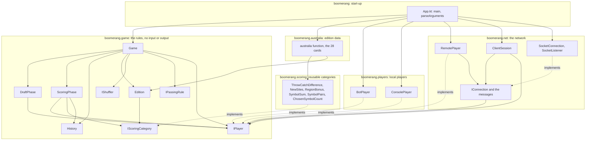
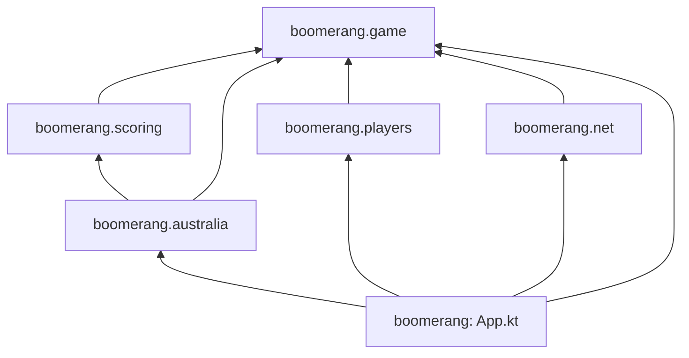
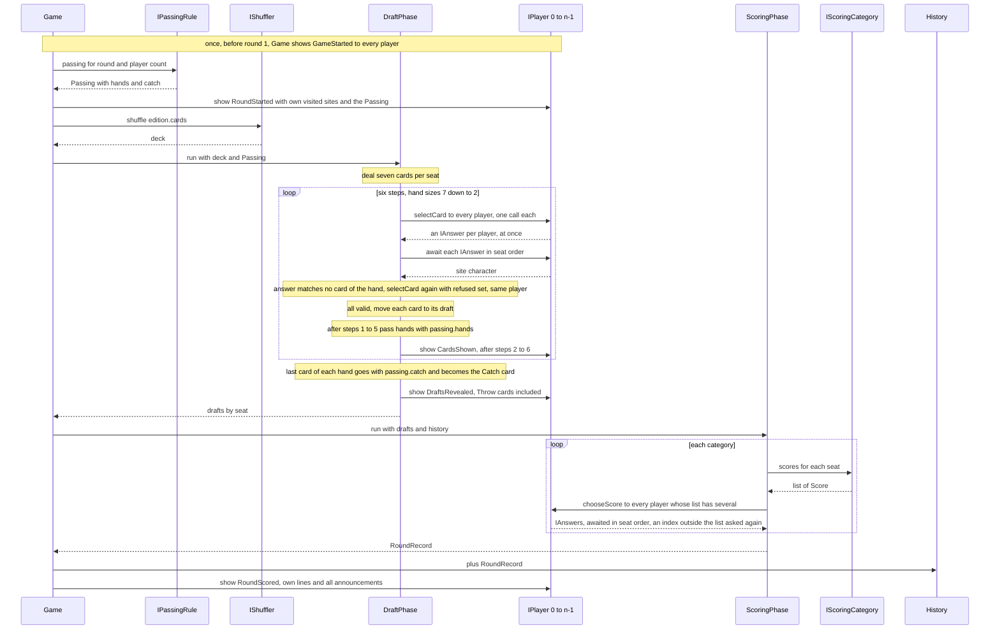

# Architecture: Boomerang Australia in Kotlin

Basis: `docs/requirements.md` (with the decisions of its section 8), `docs/legacy-findings.md`, the original
`BoomerangAustralia.java` (line numbers below refer to it) and the exam brief. Rule ids (R1 to R12, AC, S1
to S7, FC13, FC14, Q1 to Q20) are those of the requirements.

Words, each in one meaning only: **player** (never client or user in the game logic), **seat** (the index
of a player, 0 to n-1 in code, shown as player 1 to n), **hand**, **draft**, **site**, **edition** (never
game mode), **scoring category** (one line of the score sheet with the rule that fills it), **passing
rule** (which way hands and Catch card travel). "Rule" with a number means R1 to R12.

The design in five sentences. The game logic is one package, `game`, that talks to the outside through
four interfaces it owns: `IPlayer` (everything asked of and told to a player), `IShuffler` (randomness),
`IPassingRule` (directions) and `IScoringCategory` (implemented in `scoring`). An edition is a value: a
card list, a list of `IScoringCategory` objects and a tie-break order. A scoring category is stateless;
all score state lives in one immutable `History`. A bot, a console and a network connection are three
implementations of `IPlayer`. `App.kt` is the only file that knows all packages and puts the parts together.

## 1. Shortcomings of the original

| # | What the code shows | Lines | Violates | What it costs |
|---|---|---|---|---|
| 1 | One class holds card data, the round sequence, the winner, the server, the client and argument checks. Its inner `Player` holds transport, console, bot decisions, drafting, card layout and all scoring. | 293 to 424, 426 to 458, 282; `Player` 26 to 278 | SRP; low cohesion | Every change (edition, network, rule) edits the same class. Nothing can be reused or tested alone. |
| 2 | The player kind is two flags tested in `if` chains. | 53 to 57, 61 to 64, 84 to 89, 235 to 239 | OCP; no subtypes, so no substitution | A new kind of player means editing four places inside drafting and scoring. Bots are built with three `null` arguments (443, 446). |
| 3 | `Card` has one public field per symbol kind, and counting switches on the kind's name. | 13, 16, 143 to 149, 126 to 137 | OCP; not sufficient for FC14 | A new symbol kind changes `Card`, its constructor, all 28 constructor calls, `numberThings` and `printCards`. |
| 4 | Scoring is one method that computes, prints, asks and stores, with one copied block per animal. | 154 to 277; 193 to 208 | SRP, OCP; not primitive | A score cannot be computed without telling the player. A new category or edition edits this method. The copy hid the "exactly two" bug. |
| 5 | Score state lives in five fields and two locals, written from two classes. The region rule is spread over three places. | 33, 39 to 42, 323, 324; 99 to 114, 381 to 393, 269 | Cohesion; content coupling | The region bonus is reachable only through a whole game; it is checked before the Catch card arrives (381 against 396). |
| 6 | Concrete collaborators are created inside the logic: keyboard, random source, shuffle, sockets, `System.out`. | 34, 87, 327, 404, 428, 449, 56, 287, 422 | DIP | No fixed deal, no scripted player. The client and the accept loop cannot be tested at all. |
| 7 | All fields are public, and objects write each other's fields. | 7 to 10, 27 to 42; 95 and 96, 331, 385 and 386, 396, 407 to 409 | High coupling; no encapsulation | Any change to how a hand or draft is stored breaks code in the other class. |
| 8 | The client recognises a question and the end of the game by words in the text. | 432, 435 | Coupling of the protocol to the wording | Rewording a message breaks the client. |
| 9 | Both passing directions are expressions inside the drafting loop; the thread pool and a polling `sleep` are in the same loop. | 341 to 347; 337, 349 to 362 | OCP for FC13; SRP | FC13 edits the middle of the round. Every test of a round pays the sleep and runs threads. |
| 10 | Edition facts are literals in the logic: region size 4, bonus 3, names, tables, 4 rounds, index 6, "round 3 is last". | 110, 386, 269, 177, 190, 215, 229, 334, 159, 249 | OCP; not complete for FC14 | Another edition means editing every one of these lines. The typo of line 323 is such a literal. |
| 11 | Exceptions are swallowed or reduced to their message; the constructor runs the whole game. | 54, 62, 64, 421 to 423, 463 to 465; 280 to 291 | S2 | A fault ends the game with no word to the players, and hides faults from tests. |
| 12 | `Card.equals` without `hashCode`, with an unchecked cast; an unused field. | 21 to 23; 15 | Contract of `equals` (LSP towards `Object`) | Cards misbehave in hash sets and maps. |

## 2. Components, packages and dependency rules

### 2.1 Components



### 2.2 Packages (an arrow means "depends on")



All arrows point inward. `game` owns the interfaces the outer packages implement (dependency inversion).

### 2.3 Rules: what may not depend on what

1. A file in `game` may import `java.io.Serializable` and names from `kotlin.*`, nothing else: no other
   `java.*` or `javax.*`, no other `boomerang` package. Outside its import lines it contains none of
   `java.`, `javax.`, `System.`, `Thread`, `println`, `readLine`.
2. `scoring` imports from `boomerang.game` and `kotlin.*` only. It names no edition: no site, region or
   symbol name is a literal in it (the test checks string literals); values arrive through constructors.
3. An edition package imports from `boomerang.game`, `boomerang.scoring` and `kotlin.*` only. Editions never depend on
   each other. `Symbol(` is called only in an edition package, once per symbol, as a named constant.
4. `players` imports from `boomerang.game` only (plus `kotlin.*`). `net` imports from `boomerang.game`,
   `java.io` and `java.net` only. Neither knows the other, nor `scoring`, nor any edition.
5. Only `App.kt` names concrete classes of more than one outer package. Nothing imports from it.
6. `Random` is constructed only in `App.kt`. No main source file calls `shuffled()` or `random()` without a
   passed-in source.
7. Text for a player during a game is laid out only in the console files of `players`
   (`ConsolePlayer.kt`, `ConsoleMemory.kt`, `ConsoleScreens.kt`, `ConsoleLayout.kt`, `TerminalFrame.kt`,
   `CardFan.kt`). The server's own lines
   and the failure sentences are in `App.kt`. `game` composes no sentence. Three concessions, not held by a
   test: an exception of `net` carries a short reason that `App.kt` prints (D10), `RegionBonus` joins
   region names into its announcement (one string in `Score`, no list type for one category), and five
   scoring classes write one line of facts into `Score.explanation` (D18).

`DependencyRulesTest` reads the main source files, strips comments, and asserts rules 1 to 6 as written here.

## 3. Types and their operations

Signatures only, headed by file; the package is `boomerang.<folder>`. "By seat": the index is the seat.

```kotlin
// game/Cards.kt
/** One symbol on a card, for example Symbol("Animal", "Koalas"). The kind is data: a new kind needs no new type. */
data class Symbol(val kind: String, val name: String) : Serializable
/** One card of an edition: what is printed on it, nothing about how it scores. */
data class Card(
    val site: Char, val name: String, val region: String, val number: Int, val symbols: List<Symbol>,
) : Serializable
/** The cards one player has kept in a round, in the order kept: Throw card first, Catch card seventh. */
data class Draft(val cards: List<Card> = emptyList()) : Serializable {
    val throwCard: Card            // the first card; IllegalStateException if the draft is empty
    val catchCard: Card            // the seventh card; IllegalStateException if fewer than seven
    val shown: List<Card>          // every card except the Throw card
    val sites: Set<Char>
    fun count(symbol: Symbol): Int // number of cards that carry the symbol
    operator fun plus(card: Card): Draft
}
// game/IScoringCategory.kt
/** A score a player can take in one category in one round. */
data class Score(
    val points: Int,
    val chosen: Symbol? = null,        // what the player uses up by taking this score (an activity, a treasure)
    val announcement: String? = null,  // told to all players, for example the name of a completed region
    val explanation: String? = null,   // one short line of facts the points come from (D18)
) : Serializable
/** What a category may look at when it scores one player for the round just drafted. */
class ScoringContext(val seat: Int, val drafts: List<Draft>, val history: History) {
    val draft: Draft               // drafts[seat]
    val otherDrafts: List<Draft>   // the drafts of all other players, this round
    val playerCount: Int
}
/** One line of the score sheet with the rule that fills it. Stateless: the same context gives the same list. */
interface IScoringCategory {
    val name: String               // display text only; never used to find anything
    /** The scores this player may take this round, never empty. One element: that is the score.
     *  Several: the player chooses one; they are listed in the edition's order, "take none" last. */
    fun scores(context: ScoringContext): List<Score>
}
// game/History.kt
/** One line of a score sheet as it is shown to a person. */
data class ScoreLine(val title: String, val score: Score) : Serializable
/** Everything one finished round leaves behind. Both lists are by seat. */
data class RoundRecord(val drafts: List<Draft>, val scores: List<Map<IScoringCategory, Score>>)
/** Totals by seat, the total per category by seat in the edition's order, and the winning seats (several on a shared win). */
data class GameResult(
    val totals: List<Int>, val lines: List<List<ScoreLine>>, val winners: List<Int>,
) : Serializable
/** The finished rounds of a game: the single place where score state lives. Immutable. */
class History(val rounds: List<RoundRecord> = emptyList()) {
    operator fun plus(round: RoundRecord): History
    fun visitedSites(seat: Int): Set<Char>                           // sites on the drafts of all finished rounds
    fun chosen(seat: Int, category: IScoringCategory): Set<Symbol>   // what the player has used up in that category
    fun previousPoints(seat: Int, category: IScoringCategory): Int?  // points in the last finished round; null in round 1
    fun total(seat: Int): Int
    fun total(seat: Int, category: IScoringCategory): Int
    /** Highest total, then each of edition.tieBreakers in order (R12). IllegalStateException if no round is finished. */
    fun result(edition: Edition): GameResult
}
// game/Edition.kt
/** An edition: its cards, its categories in score sheet order, and its tie-break order.
 *  The constructor throws IllegalArgumentException unless site characters are distinct, category names
 *  are distinct and not blank, every tie-breaker is one of `categories` (the same object), and there are
 *  enough cards for the largest game (Game.PLAYERS.last * Game.HAND_SIZE). */
class Edition(
    val name: String, val cards: List<Card>,
    val categories: List<IScoringCategory>, val tieBreakers: List<IScoringCategory>,
)
// game/IPassingRule.kt
enum class Direction {
    TO_NEXT, TO_PREVIOUS;
    fun receiver(seat: Int, playerCount: Int): Int   // the seat that receives what `seat` passes on
}
/** The two directions of one round. Serializable: it travels in RoundStarted (D18). */
data class Passing(val hands: Direction, val catch: Direction) : Serializable
/** Decides which way the hands and the Catch card travel in a round (round is 1 to 4). */
fun interface IPassingRule { fun passing(round: Int, playerCount: Int): Passing }
/** Brief rules 6 and 9 with Q1: hands to the next player, Catch card to the previous, in every round (AC11.5). */
object StandardPassingRule : IPassingRule
// game/AlternatingPassingRule.kt
/** FC13 with Q18: in even rounds of a game of three or four players, hands to the previous player and the
 *  Catch card to the next; otherwise as StandardPassingRule. */
object AlternatingPassingRule : IPassingRule
// game/IShuffler.kt
/** Puts the cards of a deck in the order of the next deal. Returns the same cards, each once. */
fun interface IShuffler { fun shuffle(cards: List<Card>): List<Card> }
/** The production shuffler: the order comes from the random source it is given. */
class RandomShuffler(private val random: kotlin.random.Random) : IShuffler
// game/IPlayer.kt
/** An answer that is still to come. await() blocks until the player has answered; PlayerLost if none can come. */
fun interface IAnswer<out T> { fun await(): T }
/** `refused`: the answer just given to the same question that was not allowed (S1); null on the first asking. */
data class CardRequest(val hand: List<Card>, val draft: Draft, val refused: Char? = null) : Serializable
data class ChoiceRequest(
    val category: String, val scores: List<Score>, val draft: Draft, val refused: Int? = null,
) : Serializable
/** "Player 1", "Player 2" and so on: the names of players nobody has named (D18). */
fun defaultNames(playerCount: Int): List<String>
sealed interface GameEvent : Serializable
data class GameStarted(
    val seat: Int, val playerCount: Int, val edition: String,
    val names: List<String> = defaultNames(playerCount),   // by seat
) : GameEvent
data class RoundStarted(
    val round: Int, val visitedSites: Set<Char>,           // round is 1 to 4
    val passing: Passing = Passing(hands = Direction.TO_NEXT, catch = Direction.TO_PREVIOUS),
) : GameEvent
data class CardsShown(val shown: List<List<Card>>) : GameEvent                     // by seat, Throw cards excluded
data class DraftsRevealed(val drafts: List<Draft>) : GameEvent                     // by seat, all seven cards
data class RoundScored(
    val round: Int,
    val own: List<ScoreLine>,               // the receiver's score in every category, in the edition's order
    val announced: List<List<ScoreLine>>,   // by seat: the lines of each player that carry an announcement
) : GameEvent
data class GameOver(val result: GameResult) : GameEvent
data class GameAborted(val lostSeat: Int) : GameEvent
/** One seat at the table as the rules see it: something that can be asked and told. */
interface IPlayer {
    /** Puts the question to the player and returns at once. The answer is the site character of a card of request.hand. */
    fun selectCard(request: CardRequest): IAnswer<Char>
    /** As selectCard. The answer is an index into request.scores. */
    fun chooseScore(request: ChoiceRequest): IAnswer<Int>
    /** Tells the player something. Never asks. PlayerLost if the player cannot be reached. */
    fun show(event: GameEvent)
}
/** Thrown by an IPlayer that can no longer be reached. */
class PlayerLost(val player: IPlayer, cause: Throwable? = null) : RuntimeException(cause)
// game/DraftPhase.kt, game/ScoringPhase.kt, game/Game.kt
/** Rules 4 to 9: deal, Throw card, pass and select, Catch card. Knows no edition and no scoring. */
class DraftPhase(private val players: List<IPlayer>) {
    /** Deals deck[0..6] to seat 0, deck[7..13] to seat 1 and so on, runs the draft and returns the complete
     *  drafts by seat. Hands travel in passing.hands, the last card of each hand in passing.catch. */
    fun run(deck: List<Card>, passing: Passing): List<Draft>
}
/** Rule 10: for every category, asks the players who have a choice, and records every player's score.
 *  IllegalStateException naming the category if one offers no score. */
class ScoringPhase(private val categories: List<IScoringCategory>, private val players: List<IPlayer>) {
    fun run(drafts: List<Draft>, history: History): RoundRecord
}
/** Rules 1, 3, 11 and 12: checks the player count, plays four rounds, keeps the History, names the winners. */
class Game(
    private val edition: Edition,
    private val players: List<IPlayer>,
    private val shuffler: IShuffler,
    private val passingRule: IPassingRule = StandardPassingRule,
    private val names: List<String> = defaultNames(players.size),   // passed on in GameStarted, never read
) {
    // init: IllegalArgumentException naming PLAYERS if players.size is not in it (the one check of rule 1),
    // and if there is not one name per player
    /** On PlayerLost: shows GameAborted to every other player, then rethrows it. */
    fun play(): GameResult
    companion object {
        val PLAYERS: IntRange     // 2..4, the one definition of rule 1
        const val ROUNDS: Int     // 4
        const val HAND_SIZE: Int  // 7
    }
}
```

```kotlin
// scoring/ThrowCatchDifference.kt
/** R10a: the absolute difference of the numbers on Throw and Catch card. */
class ThrowCatchDifference(override val name: String) : IScoringCategory
// scoring/SiteCategories.kt
/** R10b, first half: one point per site on the draft that is not in history.visitedSites(seat). */
class NewSites(override val name: String) : IScoringCategory
/** A group of sites with the bonus for completing it first. */
data class Region(val name: String, val sites: Set<Char>, val bonus: Int)
/** R10b, second half: the bonus of every region this player completes this round and no player had complete
 *  after an earlier round. Announces the region names. */
class RegionBonus(override val name: String, private val regions: List<Region>) : IScoringCategory
// scoring/SymbolCategories.kt
/** R10c: the sum of the symbol values on the draft, turned into points by `toPoints`. */
class SymbolSum(
    override val name: String, private val values: Map<Symbol, Int>, private val toPoints: (Int) -> Int,
) : IScoringCategory
/** R10d: for each symbol, its value for every complete pair on the draft. */
class SymbolPairs(override val name: String, private val values: Map<Symbol, Int>) : IScoringCategory
/** R10e: one score per symbol that is on the draft and not in history.chosen(seat, this), worth
 *  pointsByCount[number of cards], in the order of `symbols`, then "take none" with 0 points. The table
 *  must not be empty (IllegalArgumentException); a count it has no entry for is an IllegalStateException. */
class ChosenSymbolCount(
    override val name: String, private val symbols: List<Symbol>, private val pointsByCount: List<Int>,
) : IScoringCategory
// australia/Australia.kt
/** The symbols of the edition, each declared once (LEAVES, KANGAROOS, SWIMMING and so on). */
object AustraliaSymbols
/** The 28 cards of requirements section 2, in table order. */
val australiaCards: List<Card>
/** Boomerang Australia: the cards; six categories (Throw and catch, Tourist sites, Region bonus, Collections,
 *  Animals, Activities); tie-break Throw and catch. Regions are derived from the cards, bonus 3 each.
 *  Activities in the order of brief rule 2: Swimming, Bushwalking, Indigenous Culture, Sightseeing. */
fun australia(): Edition
// players/BotPlayer.kt
/** S4: selects any card of the hand at random and takes the first score offered. Ignores events. */
class BotPlayer(private val random: kotlin.random.Random) : IPlayer
// players/ConsolePlayer.kt
/** A human at a text console. Prints every event and question; repeats a question locally until a line can
 *  be read as an answer (one character; a number). A typed option number counts from 1; "0" is not an
 *  answer and the question is repeated locally. Throws PlayerLost when the input ends.
 *  `cards`: the cards of the edition, for the map. `colour`: whether to print escape sequences. */
class ConsolePlayer(
    private val readLine: () -> String?, private val print: (String) -> Unit,
    cards: List<Card> = emptyList(), colour: Boolean = false,
) : IPlayer
/** The plain text of an event or a question, from that value alone: what a console prints that has not
 *  been shown GameStarted. */
internal fun describe(event: GameEvent): String
internal fun describe(request: CardRequest): String
internal fun describe(request: ChoiceRequest): String
// players/ConsoleMemory.kt
/** What one console has been shown so far: seat, edition, names, the round, the cards shown in it, the own
 *  draft last revealed, the own score lines per round. Display state: the game never reads it (D18). */
internal class ConsoleMemory {
    fun remember(event: GameEvent)
    fun name(seat: Int): String              // the name from GameStarted, else "Player n"
    fun giver(direction: Direction): Int     // the seat whose cards reach the own seat in this direction
    fun receiver(direction: Direction): Int  // the seat that gets the cards of the own seat
}
// players/ConsoleScreens.kt
/** The screens of docs/console-screens.md, each at most 80 characters wide. */
internal class ConsoleScreens(private val cards: List<Card>, private val paint: Paint) {
    fun of(event: GameEvent, memory: ConsoleMemory): String   // empty if the event is only remembered
    fun cardQuestion(request: CardRequest, memory: ConsoleMemory): String
    fun choiceQuestion(request: ChoiceRequest): String
}
// players/ConsoleLayout.kt
/** Adds ANSI codes around text that is already laid out; with colour off, returns the text as it is. */
internal class Paint(private val on: Boolean)
/** Card tables, one card per line, one column per symbol kind the known cards carry. */
internal class CardTable(known: List<Card>, private val paint: Paint)
internal fun regionCode(region: String): String   // WA for Western Australia, QUE for Queensland
internal fun wrap(items: List<String>, separator: String, width: Int): List<String>
```

```kotlin
// net/IConnection.kt
/** A two-way channel for messages to one peer. The only thing a transport has to provide. */
interface IConnection : AutoCloseable {
    fun send(message: Message)     // ConnectionLost if the peer cannot be reached
    fun receive(): Message         // blocks; ConnectionLost if the peer is gone or sends what is not a Message
}
class ConnectionLost(message: String, cause: Throwable? = null) : RuntimeException(message, cause)
sealed interface Message : Serializable
/** Server to client. Carries out itself on the client's local player; returns the reply to send, if any. */
sealed interface ServerMessage : Message {
    fun deliverTo(player: IPlayer): ClientMessage?
    val closes: Boolean get() = false
}
data class Tell(val event: GameEvent) : ServerMessage
data class AskCard(val request: CardRequest) : ServerMessage
data class AskChoice(val request: ChoiceRequest) : ServerMessage
data object Bye : ServerMessage                 // closes = true
/** Client to server. */
sealed interface ClientMessage : Message
data class CardAnswer(val site: Char) : ClientMessage
data class ChoiceAnswer(val index: Int) : ClientMessage
// net/RemotePlayer.kt
/** Server side: stands in for the player at the other end of a connection. Turns ConnectionLost and a
 *  reply of the wrong kind into PlayerLost. A failed send of a question surfaces as PlayerLost in await(),
 *  so selectCard and chooseScore always return; a failed send in show(event) throws PlayerLost at once.
 *  close() sends Bye and closes the connection. */
class RemotePlayer(private val connection: IConnection) : IPlayer, AutoCloseable
// net/ClientSession.kt
/** Client side: receives server messages, delivers each to the local player, sends the reply, until Bye. */
class ClientSession(private val connection: IConnection, private val player: IPlayer) { fun run() }
// net/SocketConnection.kt
/** The transport of today: Java object streams over a TCP socket. */
class SocketConnection(socket: java.net.Socket) : IConnection {
    companion object { fun open(host: String, port: Int): SocketConnection }   // the client's end; ConnectionLost if no server answers
}
/** The server's end. Port 0 takes any free port; `port` is the one in use. ConnectionLost if the port cannot be opened. */
class SocketListener(port: Int) : AutoCloseable {
    val port: Int
    fun accept(): IConnection
}
// App.kt (package boomerang)
sealed interface Start
data class ServerStart(val humans: Int, val bots: Int, val alternate: Boolean = false) : Start   // alternate: FC13
data class ClientStart(val host: String) : Start
data class Usage(val message: String) : Start      // states Game.PLAYERS and the two command forms
/** S3: "<humans> <bots>", two whole numbers not below 0 whose sum is in Game.PLAYERS, is a server;
 *  a third argument, exactly the word "alternate", asks for FC13 (AC13.3); "<host>" is a client;
 *  anything else is Usage. */
fun parseArguments(args: Array<String>): Start
/** AC13.3, AC13.4: AlternatingPassingRule if start.alternate, else StandardPassingRule. */
internal fun passingRuleFor(start: ServerStart): IPassingRule
/** Colour is on only with a console and without the environment variable NO_COLOR (empty counts as not set). */
internal fun useColour(hasConsole: Boolean, noColor: String?): Boolean
/** The names by seat: humans "Player n", bots "Bot n", n being the seat plus one. */
internal fun playerNamesFor(start: ServerStart): List<String>
/** Client only: wraps the ConsolePlayer, passes everything on, and notes whether the end of the game was shown. */
private class EndWatcher(private val player: IPlayer) : IPlayer { var sawTheEnd: Boolean }
fun main(args: Array<String>)                      // the composition root; reports every failure in words (S2)
const val PORT: Int                                // 2048
```

Seats: the humans take seats 0 to humans-1 in the order they connect, the bots the rest.

## 4. How one round runs



`Game.play` first shows `GameStarted` to every player, once, before round 1. After round 4 it calls
`history.result(edition)` and shows `GameOver` to all (AC12.7). No fifth deal.

**Selection "at the same time" without threads.** `selectCard` only puts the question and returns an
`IAnswer`. `DraftPhase` calls it for every player first, so all players are choosing at once, and only then
awaits the answers in seat order, on one thread. What "put the question" means is the player's business: a
`RemotePlayer` writes one message and its `IAnswer` reads the reply from the same connection; a `BotPlayer`
has its answer ready; a scripted player in a test returns the next value of its script. The scoring
choices are asked the same way. Proof, from the order of statements in `DraftPhase.run`:

- **AC7.4, AC5.3.** A selection of the current step can reach another player in two ways only: a
  `CardsShown` event, or the hand in a later `CardRequest`. Both are sent after the loop that awaits and
  checks every seat's answer. A repeated question after a refusal goes to the same player and contains only
  that player's own hand and draft. The Throw card is in no `CardsShown`; it appears first in
  `DraftsRevealed` (AC5.6).
- **AC5.5, AC6.3.** Hands are passed by one statement placed after that loop. It cannot run earlier.
- **AC7.3.** `CardsShown` is built from `Draft.shown` of all seats and shown to all seats, after the pass.

## 5. Decisions

Each: the choice, what was rejected, why, and a defence to say aloud.

**D1. How an edition enters the program.** An edition is an object of the final class `Edition`, built by a
function such as `australia()` and handed to `Game` by `App.kt`. Rejected: an `IEdition` interface with one
class per edition (getters only, no operation the game calls), and an abstract factory (an edition is not a
family of products). A new edition is a new value, so `game` never changes (OCP).
Defence: An edition differs in data and in its list of categories, not in behaviour of its own, so it is
an object, not a subclass. The behaviour that differs is in the categories.

**D2. Where game logic ends and input and output begin.** At `IPlayer`, which `game` owns: three
operations, all called by the game. Rejected: a "send string, read string" channel as in the original
(lines 52 to 66), which ties rules to wording. Whether an answer is allowed (card in hand in any letter
case, index in the list) is checked in `game`, once, for all kinds of player; whether a typed line is an
answer at all is checked by `ConsolePlayer`. The game composes no text: a refusal is the field `refused`.
Defence: The rules ask a player and tell a player, and that is all they know. Everything behind that
interface can be replaced, including by a script in a test.

**D3. What a card is, and new symbol kinds.** A card is a value with a list of `Symbol(kind, name)`. A new
kind is new data in an edition file; `Card`, `Draft` and the console (one line per card, one column per
kind found on the cards) do not change. Rejected: one field per kind (the original) and an enum of kinds in `game`, which
would be edited for Europe. A symbol's value is not on the card: it belongs to the category that scores it.
A typo is caught in three places: each symbol is declared once as a constant and used by that name, so a
wrong reference does not compile; `DependencyRulesTest` forbids `Symbol(` outside edition packages; the one
declaration is checked by the R2 tests (AC2.5, AC2.6). One main source file reads `kind`: `CardTable` in
`players/ConsoleLayout.kt` makes one column per kind and uses the kind as the column head (D18).
Defence: The brief says other editions bring new symbols, so the set of kinds must be open, and that means
data. A symbol is typed once and referred to by name everywhere else.

**D4. The shape of a scoring category.** One interface, one operation: `scores(context)` returns the scores
the player may take, never empty. One element is the score; several mean the player chooses, with "take
none" as an ordinary element. `ScoringPhase` treats all categories alike: it asks when the list has more
than one element. Rejected: a pair of operations (options, then score with the chosen option), where most
categories would ignore a parameter; a second interface for categories with a choice, which needs a type
check; a callback through which a category asks the player, which puts input and output into scoring. The
convention "several means choose" lives in the contract of `scores`, not in the type system. A new
category is one class.
Defence: Every category answers one question, "what can this player score here now". Most give one answer,
Activities gives several, and the phase needs no knowledge of which is which.

**D5. Where score state lives.** In `History`: the drafts and scores of the finished rounds, immutable.
Categories are stateless and read or derive what they need. Nothing is found by a string: the key is the
category object itself (`history.previousPoints(seat, this)`), tie-breakers are category objects that
`Edition` checks at construction, and `name` is display text. Rejected: state inside each category object.
It would make categories mutable and order dependent, need fresh objects per game, make `NewSites` and
`RegionBonus` share or duplicate visited sites, and need a getter to show a player their visited sites.
Cost: visited sites are recomputed each round from at most 28 cards.
The needs of requirements 6.1 point 4: Throw and Catch: `draft.throwCard`, `draft.catchCard`. Own history:
`visitedSites`, `chosen`, `previousPoints`. Other players' cards and the player count: `otherDrafts`,
`playerCount`. Claims by order of arrival with shared places: derived from the drafts of all seats in
`history.rounds` (who had it complete before this round) and from `drafts` (who completes it now).
Relations between sites: constructor data of the category. A decision by the player: several scores.
Defence: One score sheet, one place. A category is a pure function of the round and the history, so one
call tests it and state cannot drift apart as it did in the original.

**D6. Who decides the directions.** An `IPassingRule` given to `Game`, asked once per round for a
`Passing(hands, catch)`. `DraftPhase` computes no direction: "which way does the Catch card go" has one
home. `StandardPassingRule` is brief rules 6 and 9 with Q1. Rejected: a flag `alternate` in `Game` (an `if`
on a flag); the direction as part of `Edition` (the rule is optional per game, not per edition); the Catch
direction fixed in `DraftPhase` as "opposite to the hands" (the rulebook's reading would then need a change
in `game`). Not built: a general list of optional-rule hooks; one optional rule is named.
Measured: FC13 is implemented as the proof. It took one new file of 14 lines in `game`
(`AlternatingPassingRule.kt`) and `App.kt` learning one option: 28 lines added, 7 removed (the third
property of `ServerStart`, the parse branch, the usage text, `passingRuleFor`, one line handing the rule to
`Game`). No existing file of `game`, `scoring`, `australia`, `players` or `net` was edited. The estimate
made before, "one line at start-up", was too low: a rule that can be switched on needs a switch. Shown by
`git diff --stat tests-locked-2 HEAD -- app/src/main`. Tests: `AlternatingPassingRuleTest`,
`AlternatingGameTest`, `AlternateArgumentTest`, 19 tests.
Defence: Brief and rulebook disagree on the Catch direction, and FC13 changes both directions, so both are
one decision in one object. Adding FC13 touched one new file and the start-up file, nothing else.

**D7. How kinds of player differ.** By class: `BotPlayer`, `ConsolePlayer`, `RemotePlayer`, each a full
substitute for `IPlayer` (LSP). No `isBot`, no `online`, no base class. The server hosts no player (Q10):
its seats are `RemotePlayer`s and `BotPlayer`s, and each client runs a `ConsolePlayer`. `RemotePlayer` is a
proxy for the `ConsolePlayer` at the other end.
Defence: The game cannot tell a bot from a human or a local from a remote one, because it only sees
`IPlayer`. A new kind of player is a new class and nothing else changes.

**D8. Simultaneous selection.** `selectCard` returns an `IAnswer`; the game asks all, then awaits all
(section 4). The server has no thread, executor or lock. The original needs a thread pool (lines 337 to
362) only because its `addCardToDraft` sends the question and blocks on the answer in one call. Here asking
and collecting are two steps, so all questions are out before any answer is read, and the waiting happens
in the client processes and the socket buffers, not in server threads. Rejected: blocking calls on one
thread per player behind a helper interface, which is real concurrency that tests would not exercise.
`IAnswer` is preferred over `CompletableFuture` because that class promises completion by another thread,
cancellation and executors, none of which exist here; `IAnswer` has one method and a test double is a
lambda. Cost: answers are read in seat order, so a lost player is noticed when that seat is next awaited.
Stance: a hand-made type stands where a library type exists. That is the smaller cost because the library
type would bring a threading model into `game`. The way out is local: `IAnswer` has one method, and a
connection with reader threads can sit behind `IConnection` without touching `game`.
Defence: "At the same time" means nobody sees another's selection before making their own. All questions
go out before any answer is read, and nothing is shown or passed before the last answer is in.

**D9. What travels between server and client.** Typed messages, not text: `Tell(event)`, `AskCard`,
`AskChoice`, `Bye` one way, `CardAnswer`, `ChoiceAnswer` the other, as Java objects over object streams.
The payloads are the game's own immutable values, so nothing is defined twice. Each `ServerMessage` carries
out itself on the client's local player (`deliverTo`), so the client has no chain on message types and
never looks at wording. Rejected: one line of text per message with an encoder in `net`, about a hundred
lines and their tests that no requirement asks for.
Stance: the values of `game` carry the marker `java.io.Serializable`, so `game` is not free of the JDK.
That is the smaller cost because the marker has no methods and changes no signature, and the alternative is
a second set of classes or an encoder. The dependency rule says so exactly (section 2.3 rule 1) and a test
holds it. The way out: delete `: Serializable` in five files of `game` and add a connection class in `net`
that encodes `Message` itself. A concrete cost: `DraftPhase` copies each dealt hand (`toList()`), because a
`subList` view into the deck cannot be serialized.
Defence: Client and server agree on types, never on words. The transport is one class behind
`IConnection`, and the game's values travel as they are.

**D10. Error handling.** Expected situations are values, failures are exceptions, nothing is swallowed.

- An answer that is not allowed is not an exception: nothing changes and the same player is asked again
  with `refused` set (S1).
- A lost player (Q13): `SocketConnection` turns end of stream, a reset and a write failure into
  `ConnectionLost`; `RemotePlayer` turns that into `PlayerLost`, the only failure `game` knows. `Game.play`
  shows `GameAborted(lostSeat)` to every other player and rethrows; a second loss while doing so is attached
  to the first (`addSuppressed`), not dropped. `main` reports it and closes all connections.
- A port in use and an unreachable server are turned into `ConnectionLost` inside `net`, each with a
  short reason written there, where the failure is known. `main` catches `PlayerLost` and `ConnectionLost`
  only, names no `java.net` type, puts the reason into its sentence and exits with a non-zero status. It
  cannot name the lost seat (`PlayerLost` carries the player); the clients learn it through `GameAborted`.
  Bad arguments are the value `Usage`. On a client, a session that ends before `GameOver` or `GameAborted`
  was shown has its own sentence, and so has the end of the client's own input (`runClient`, `EndWatcher`).
- A broken invariant (`require`, `check`) is a programming error and crashes with its stack trace. Guards:
  too few cards (`Edition`), no score offered (`ScoringPhase`), a points table too short (`ChosenSymbolCount`).
- Known limit: a player who stays connected and silent makes the game wait, as in the original; no
  requirement names a time limit. One would be added behind `IConnection`, with no change in `game`.

Defence: A wrong answer is part of play, so it is a value and the player is asked again. A closed or
broken connection ends the game for everyone with a message, and no catch block is empty.

**D11. Who controls randomness.** `App.kt` takes `kotlin.random.Random.Default` and gives it to
`RandomShuffler` and to each `BotPlayer`. `Game` asks the `IShuffler` once per round. Rejected: a `Random`
passed into `Game` (a test could fix a deal only by searching for a seed) and a global generator.
Defence: Chance enters at two named points, both handed in from outside. A test passes a shuffler that
returns the deal it wants.

**D12. Packages.** By reason to change: `game` (rules 1 to 12), `scoring` (scoring mechanisms),
`australia` (one edition's data), `players` (local kinds of player), `net` (transport), `App.kt`. The
categories are named by mechanism (`SymbolPairs`) and configured by the edition with names and values.
Rejected: classes in Australia's terms inside `australia` (`Animals`): Europe would depend on `australia`,
or the classes would be moved and renamed when the second edition arrives.
Defence: Each package has one reason to change. Europe's Transport is Australia's Animals with other
names, so the mechanism is shared and the names are data.

**D13. How the code is tested.** From the inside out, JUnit only, no library for doubles: categories with a
hand-built `ScoringContext` (R10); the cards as data (R2); `DraftPhase` with a fixed deck and scripted
players (R4 to R9); `ScoringPhase`, `History.result` and `Game` with scripted players and a fixed shuffler
(R1, R3, R10e, R11, R12); `parseArguments` (R1); `ConsolePlayer` with strings; `RemotePlayer` and
`ClientSession` over an in-memory connection pair. Two more: `DependencyRulesTest`, because a dependency
rule that no test checks erodes; and one loopback test of `SocketConnection` on a free port, because that
class is otherwise the only one no test runs; `GameOverTheWireTest` plays a game through serialized
messages. The doubles (`ScriptedPlayer`, `InMemoryConnection`, `SerializingConnection`, `FixedCategory`)
and two helpers (`Table`, `AustraliaSheet`) live in the test sources, in `boomerang/support/`.
Defence: Every rule is tested where it lives, without console, socket or chance. No production type
exists for the tests' sake: the rules need `IPlayer` and `IShuffler` anyway.

**D14. Naming.** Idiomatic Kotlin, with one rule for the prefix: **an open (not sealed) interface gets
`I`**. There are six, each with operations: `IPlayer`, `IScoringCategory`, `IPassingRule`, `IShuffler`,
`IConnection`, `IAnswer`. In the main sources `IShuffler` and `IConnection` have one implementation each
(their second is a test double) and `IAnswer` only lambdas. **A sealed interface gets no
prefix**: `GameEvent`, `Message`, `ServerMessage`, `ClientMessage`, `Start` are closed families of values,
complete in one file, that nothing outside can implement, so they are data, not seams. Implementations say
what sets them apart (`BotPlayer`, `SocketConnection`). A file is named after its interface or main class.
Defence: The prefix marks the places where the design is meant to be extended. A sealed family cannot be
extended from outside, so it is named like the values it holds.

**D15. Events as data, and the type tests that remain.** What a player is told is a sealed family of seven
values and one operation `show(event)`. Rejected: one method per event on `IPlayer`, which would make
`BotPlayer` and every test double implement seven methods they ignore (ISP). The complete list of tests on
a type in the design:

1. Three `when`s over `GameEvent` in `players`: `describe(event)` in `ConsolePlayer.kt` (the plain text),
   `ConsoleScreens.of` (the screen) and `ConsoleMemory.remember` (what to keep). They turn data into text
   at the outermost edge; a text method on the events would put wording into `game`. The compiler rejects
   each when an event is added and not handled.
2. `main`: a `when` over `Start`. Choosing what to build is the job of the composition root.
3. Input validation where objects arrive from another process, never dispatch. `SocketConnection.receive`
   checks that the object read is a `Message`, because a stream can deliver any object. `ClientSession`
   checks that it is a `ServerMessage`, because only those can be delivered to a player. `RemotePlayer`
   checks each reply (`CardAnswer`, `ChoiceAnswer`), because a client may answer the wrong question. Each
   failure is `ConnectionLost` or `PlayerLost`.
4. `EndWatcher` in `App.kt`: `event is GameOver || event is GameAborted`. The client must know whether the
   game ended or the session merely stopped; the check stays out of `game` and `net`, in start-up code.

There is no other test on a type. `Direction.receiver` is a `when` on the enum's own two values.

Defence: Behaviour that varies is behind interfaces. A `when` remains only where data meets the outside
world, and the compiler checks it is complete.

**D16. One home for rule 1.** `Game.PLAYERS` is the only definition of the range and the `require` in
`Game`'s constructor the only check of it. `parseArguments` decides nothing itself: it asks whether the sum
is in `Game.PLAYERS`, so that a wrong count is refused before a port is opened, and builds its message from
the same constant. Rejected: the literals 2 and 4 in both places.
Defence: The range is written once, in the game. The command line only asks the game's constant.

**D17. Decided details.** Six score lines, "Region bonus" beside "Tourist sites": the original prints them
separately and the brief scores the bonus as its own amount; a later change of the terminal output may
group them without touching scoring. Activities are listed as the brief lists them under rule 2 (line 83):
Swimming, Bushwalking, Indigenous Culture, Sightseeing, so the bot's "first offered" is index 0 with no
special case. Visited sites are sent once per round in `RoundStarted`: the original shows them (lines 73 to
77) and S7 keeps the information. "2 0" waits for two clients, and humans take the first seats: the server
hosts no player (Q10), and R6 and R9 are defined on a fixed seat order.
Defence: Each follows a decision of requirements section 8 or keeps information the original gave.

**D18. The console screens (`docs/console-screens.md`, beyond the brief).** Four additions, none of them a
rule of the game.

- *Display memory.* `ConsolePlayer` keeps a `ConsoleMemory` of what it was shown, because a screen with a
  map and a score sheet needs more than the one event that triggers it. It is display state of one console:
  no other class reads it, and `History` stays the single place of score state (D5). The console learns the
  cards of the edition through its constructor (`App.kt` passes `australia().cards`), reads regions, region
  codes and symbol kinds from them, and so names no edition. A console that was never shown `GameStarted`
  prints the plain texts of `describe`, as before.
- *Names.* `GameStarted` carries `names`, by seat. `Game` takes them as a constructor argument, checks only
  their number, and passes them on: it does not know what a bot is. "Player n" is written in three places,
  each for another case: `defaultNames` in `game/IPlayer.kt` (nobody gave names: the default of `Game` and
  of `GameStarted`), `playerNamesFor` in `App.kt` (humans are "Player n", bots "Bot n") and `playerName`
  in `ConsolePlayer.kt` (a console that was told no name for a seat).
- *Passing.* `RoundStarted` carries the `Passing` the rule answered for the round, so `Passing` is
  `Serializable`. `Game` asks the rule before it shows the start of the round. The console names the
  player a hand came from and the player the Catch card comes from. This closes review finding L7.
- *Explanations.* `Score.explanation` is one short line of facts (which cards, which numbers), filled by the
  five scoring classes that leave no choice. `ChosenSymbolCount` leaves it empty: its score names the
  symbol, and the console counts the cards of the draft that carry it. Known cost: a sentence is now
  written inside a scoring class, as `announcement` already is; rule 7 of section 2.3 names it as a
  concession. Second cost: `SymbolSum` says "doubled" when the points are twice the sum, which it learns by
  comparing the two numbers, since `toPoints` is a function it cannot read. The console decides where and
  whether an explanation is printed.

Rejected: the deck inside an event (it is the same on both sides and never changes), a name list in
`net` (names are told like everything else, through `IPlayer`), and a structured explanation type (one
line of text per score is all the console prints).
Defence: The game still only asks and tells. What grew is what it tells (names, directions, a reason), and
a console that remembers what it was told.

## 6. Design patterns

Used:

| Pattern | Where | Why |
|---|---|---|
| Strategy | `IScoringCategory` (FC14), `IPassingRule` (FC13, Q1), `IShuffler` (S5, AC3.2) | The three points where a named change or requirement replaces an algorithm. Each has one caller in `game`. |
| Proxy (remote) | `RemotePlayer` for the `ConsolePlayer` on the client | The game calls a remote human exactly as a local player (requirements 6.3). |
| Command | `ServerMessage.deliverTo(player)` | A message knows what to do on arrival, so the client has no chain on message types or words. |
| Dependency injection by constructor, one composition root | every class; `App.kt` | DIP without a framework. It is what makes a round playable in a test. |
| Adapter | `SocketConnection` turns object streams and their exceptions into `IConnection` and `ConnectionLost` | Confines the transport to one file (requirements 6.3). |
| Deferred result (a minimal future) | `IAnswer<T>` | Rule 7 without threads in the game (D8). |
| Value object | `Card`, `Symbol`, `Draft`, `Score`, events, `History` | Immutable data can be shared, sent and compared without copies. |

Considered and declined:

| Pattern | Why not |
|---|---|
| Abstract Factory or an `IEdition` interface | An edition is data plus a list of categories (D1). |
| Template Method (`AustraliaGame` extends `Game`) | Inheritance would tie each edition to the drafting sequence. Composition keeps `Game` closed. |
| State for the phases of a round | The sequence is linear and fixed. Two classes called in order are clearer. |
| Observer for events | The receivers are the fixed list of players. Subscribing would be unused. |
| Visitor over `GameEvent` | The same switch as the sealed `when`, with more code (D15). |
| Decorator or a hook list for optional rules | One optional rule is named. `IPassingRule` is its seam (D6). |
| Chain of Responsibility for tie-breaks | An ordered list of categories compared in turn is enough. |
| Singleton | State is passed in. The only `object`s (the two passing rules, `Bye`, `AustraliaSymbols`) hold no state. |
| Composite for "Tourist sites and region bonus" | Two entries in the edition's list give the same result (D17). |
| A registry of editions or a plug-in loader | One edition exists. The second needs a switch in `App.kt`, as FC13 did (D6). |

## 7. Quality attributes

### 7.1 Modifiability

| Change | New files | Existing files changed |
|---|---|---|
| **FC13** alternating direction (done, measured in D6) | `game/AlternatingPassingRule.kt`, 14 lines: in even rounds with three or four players, hands `TO_PREVIOUS` and Catch `TO_NEXT` (Q18) | `App.kt` only: 28 lines added, 7 removed, for the switch |
| The rulebook's Catch direction | one `IPassingRule` class | `App.kt` |
| **Another transport**, an answer time limit, earlier notice of a lost player (requirements 6.3) | `net/<New>Connection.kt` with its listener | `App.kt` |
| A client that is not a console | a new `IPlayer`, handed to `ClientSession` | `App.kt` |
| Console wording or layout | none | the console files of `players` only (`ConsoleScreens.kt`, `ConsoleLayout.kt`, and for a real terminal `TerminalFrame.kt`, `CardFan.kt`) |

### 7.2 Extensibility

| Change | New files | Existing files changed |
|---|---|---|
| **FC14 Europe** | `europe/Europe.kt` (symbols, cards, edition), `europe/NationalTreasures.kt`, `europe/PassportBonus.kt` | `App.kt`: a switch for the edition, not measured; FC13's cost 28 lines (D6) |
| **FC14 USA** | `usa/Usa.kt`, `usa/ThrowIfCaught.kt`, `usa/Americana.kt`, `usa/WestEastRoute.kt` | `App.kt`, the same switch |
| A new symbol kind | none: a constant such as `Symbol("Treasure", "Art")` in the edition's file | none |
| A new kind of player | one `IPlayer` class | `App.kt` |

The acceptance checks against the signatures of section 3 (described, not code to be written now):

- **Americana (USA).** `scores(c)`: `sum` is the total of `values[s] * c.draft.count(s)`; `previous` is
  `c.history.previousPoints(c.seat, this) ?: 0`; the result is the one score `sum` if `sum > previous`,
  else 0. After a 0 the threshold is 0, so any sum of 1 or more scores, as the rulebook says.
- **National Treasures (Europe).** `scores(c)`: for every treasure `t` with `c.draft.count(t) >= 1` that is
  not in `c.history.chosen(c.seat, this)`, a `Score(factor[c.playerCount] * c.otherDrafts.sumOf {
  it.count(t) }, chosen = t)`; then `Score(0)`. `ScoringPhase` sees several scores and asks the player
  through `chooseScore`, exactly as for Activities.
- **Passport, west to east route.** Order of arrival from `History`: how many seats had it complete before
  this round. Pathways and coasts are constructor data of `WestEastRoute`.
- **Cuisine, Transport, Europe's region bonuses.** No new class: `SymbolSum` with another `toPoints`,
  `SymbolPairs` and `RegionBonus` with other data.
- **Tie-break chains.** `Edition.tieBreakers`, for Europe: the passport category, then Throw and catch.

### 7.3 Testability

- **"Play a round with a fixed deal and scripted players, no console, no socket, no random shuffle."**
  `DraftPhase(scripted).run(deck, Passing(TO_NEXT, TO_PREVIOUS))` returns the drafts;
  `ScoringPhase(australia().categories, scripted).run(drafts, History())` returns the scores. The deal is
  the order of `deck`. There is no thread, sleep, port or keyboard on that path.
- Every category is a pure function of a `ScoringContext` that a test builds in three lines (D5).
- Chance enters only through `IShuffler` and the `Random` given to `BotPlayer` (D11).
- The network code is tested without a socket through `IConnection`; the console through two lambdas.

### 7.4 SOLID and Booch, in one line each

- **SRP, cohesion:** each class has the one responsibility written above its signature.
- **OCP:** editions, categories, passing rules, players and transports are added as new classes.
- **LSP:** every `IPlayer` honours one contract (question put at once, answer awaited); every
  `IScoringCategory` is stateless and returns a non-empty list.
- **ISP:** `IPlayer` has three operations, `IConnection` two, `IScoringCategory` one, and every one is
  called by its client. Three implementations leave something unused by nature: `BotPlayer.show` is
  empty, `StandardPassingRule` ignores its parameters, `Bye.deliverTo` ignores the player.
- **DIP, coupling:** `game` owns its interfaces; packages meet only at them and at immutable values.
- **Sufficiency, completeness:** `ScoringContext` carries all that requirements 6.1 point 4 lists, no more.
- **Primitiveness:** `Draft`, `History` and `Direction` offer only operations that need their internals.

## 8. Files, in the order to implement them

All under `app/src/main/kotlin/boomerang/`, 25 files. Inside out: a file uses only files above it, except
that `IScoringCategory.kt` and `History.kt` refer to each other, and that `Draft` in `Cards.kt` and
`Edition` read `Game.HAND_SIZE` (and `Game.PLAYERS`) from `Game.kt`. That second cycle inside the package
is kept on purpose: the number 7 has one home. Contents are the blocks of section 3.

1. `game/` (11): `Cards.kt`, `IScoringCategory.kt`, `History.kt`, `Edition.kt`, `IPassingRule.kt`,
   `IShuffler.kt`, `IPlayer.kt`, `DraftPhase.kt`, `ScoringPhase.kt`, `Game.kt`, and for FC13
   `AlternatingPassingRule.kt`
2. `scoring/` (3): `ThrowCatchDifference.kt`, `SiteCategories.kt`, `SymbolCategories.kt`
3. `australia/` (1): `Australia.kt`
4. `players/` (5): `BotPlayer.kt`, `ConsolePlayer.kt`, and for the console screens (D18)
   `ConsoleLayout.kt`, `ConsoleMemory.kt`, `ConsoleScreens.kt`
5. `net/` (4): `IConnection.kt`, `RemotePlayer.kt`, `ClientSession.kt`, `SocketConnection.kt`
6. `App.kt` (1; exists as a stub and is replaced)

What shares a file changes for the same reason, never across a dependency rule: `Draft` with the cards;
events and requests with `IPlayer`; the categories by what they read (numbers, sites, symbols); symbols,
cards and edition of Australia; the plain texts with `ConsolePlayer`; the messages with `IConnection`;
argument parsing with `main`. Kept apart on purpose: `DraftPhase`, `ScoringPhase` and `Game` (each tested
alone); one file per seam interface; `RemotePlayer` and `ClientSession` (two different processes).

## 9. What does not fit cleanly

No question is open. Known limits, each stated where it is decided: a silent player makes the game wait,
and a lost player is noticed when that seat is next awaited (D10, D8); `game` carries
`java.io.Serializable` (D9); four `when`s on a sealed type, four checks of arriving objects and one check
in `EndWatcher` remain (D15); "several scores means the player chooses" is a contract, not a type, and a
choice is always a symbol (D4); `kind` and the display names are strings (D3). Limits stated only here:

- **A stray connection can stall the lobby**: a peer that sends nothing holds `accept`, one that sends
  other bytes ends the server. It follows from having no time limit.
- **The object stream is never reset** and has no input filter: both ends keep every message of a session.
- **The screens are 80 characters wide for the cards of Australia.** The columns of a card table grow with
  the longest name and symbol of the cards given, so an edition with longer names needs a wider terminal
  or a narrower table. In the revealed drafts the mark "Throw" or "Catch" takes the place of the region
  code, because a line has room for one of the two.
- **`GameAborted(-1)` is possible** if `PlayerLost` names an object that is not a seat; no class here does.
- **Europe and USA card lists were not examined** (requirements 6.1). If a site there is not one character,
  `site` changes type, which touches `Card`, `CardRequest`, `CardAnswer` and `visitedSites`.
- **The passport rule's "highest available score"** after a shared first place is ambiguous in the
  rulebook; `History` supports either reading.
